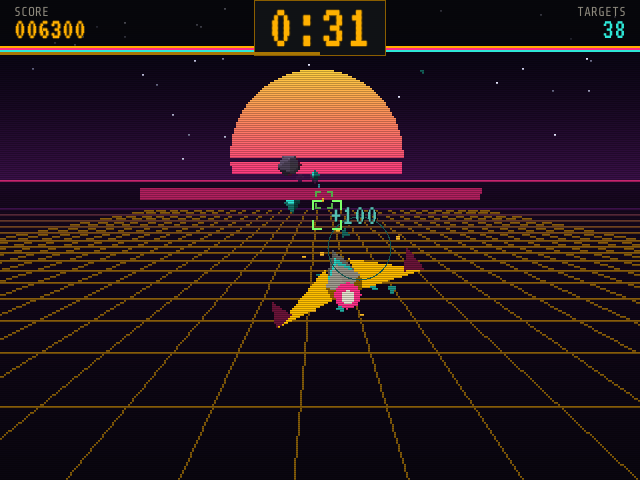

# Space Shooter for Miyoo Mini / Mini Plus

A 60-second polygon space shooter for OnionOS. Shoot the drones, dodge everything else.



Built by Claude, Anthropic's AI model, for snyderman3000. Written in Go with a small software polygon renderer (flat shading, fog, near-plane clipping), synthesised sound, and a tiny C helper for audio output.

## Install

Download `SpaceShooter-vX.Y.Z-OnionOS.zip` from the latest release, copy its `App` folder to the root of the SD card, or install it from Mixtape.

## Controls

| Button | Action |
|---|---|
| D-pad | Fly |
| A / B (hold) | Fire |
| L / R (hold) | Knife-edge bank: faster sideways dodge |
| START | Pause |
| SELECT | Music on/off |
| MENU | Pause / exit |

## Build

Needs Go 1.24+ and zig (`pip install ziglang`).

```sh
./build.sh          # tests, builds the ARM binary and sfxd, writes dist/*.zip
```

For a desktop run without the device:

```sh
go run . -shot play -t 30 -out play.png   # render a scene
go run . -bot 10                          # autopilot playthroughs, prints results
```

## Layout

- `game.go`, `models.go`, `render3d.go`: simulation, meshes, polygon renderer
- `draw.go`, `gfx.go`: HUD, menus and text
- `audio.go`, `sfx/sfxd.c`: synth and the OSS audio helper
- `device.go`: Miyoo framebuffer and buttons
- `store.go`: config and scores (`data/`)

## Licence

MIT. Fonts are under the SIL Open Font License; see `THIRD_PARTY_NOTICES.md`.
